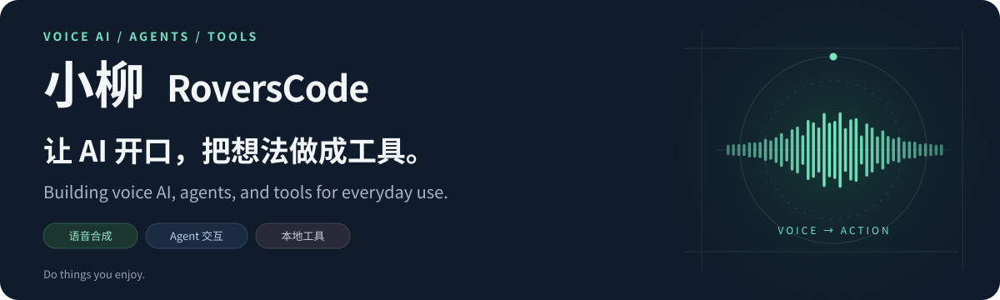
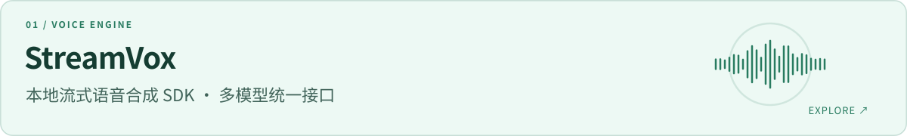
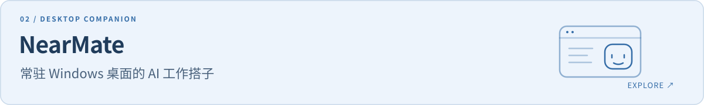

<a href="https://github.com/RoversCode">
  <picture>
    <source media="(max-width: 600px)" srcset="assets/hero-mobile.svg">
    
  </picture>
</a>

**语音 AI 与 Agent 开发者。** 我是小柳，关注语音合成、Agent 交互，以及能在本地使用的工具和产品。

从模型接入到真实使用，持续做自己感兴趣的事，也把积累整理成可以复用的项目。

[浏览全部项目 ↗](https://github.com/RoversCode?tab=repositories) · [常用 Agent Skills ↗](https://github.com/RoversCode/xiaoliu-skills)

## 项目

<a href="https://github.com/RoversCode/StreamVox">
  <picture>
    <source media="(max-width: 600px)" srcset="assets/streamvox-mobile.svg">
    
  </picture>
</a>

以统一接口接入多种 TTS 模型，支持边合成边播放。Apache-2.0 开源，面向本地语音应用开发。

[源码与文档 →](https://github.com/RoversCode/StreamVox)

<a href="https://github.com/RoversCode/NearMate">
  <picture>
    <source media="(max-width: 600px)" srcset="assets/nearmate-mobile.svg">
    
  </picture>
</a>

把角色、语音和屏幕上下文带到桌面，陪你交流并推进任务。仓库提供产品介绍、使用手册与安装包。

[了解与下载 →](https://github.com/RoversCode/NearMate)

## 工作流与积累

[**xiaoliu-skills**](https://github.com/RoversCode/xiaoliu-skills) — 整理常用 Agent Skills，把项目文档、设计、领域建模、实施计划与知识收尾串成开发工作流。

---

Do things you enjoy. · 小柳 / RoversCode
